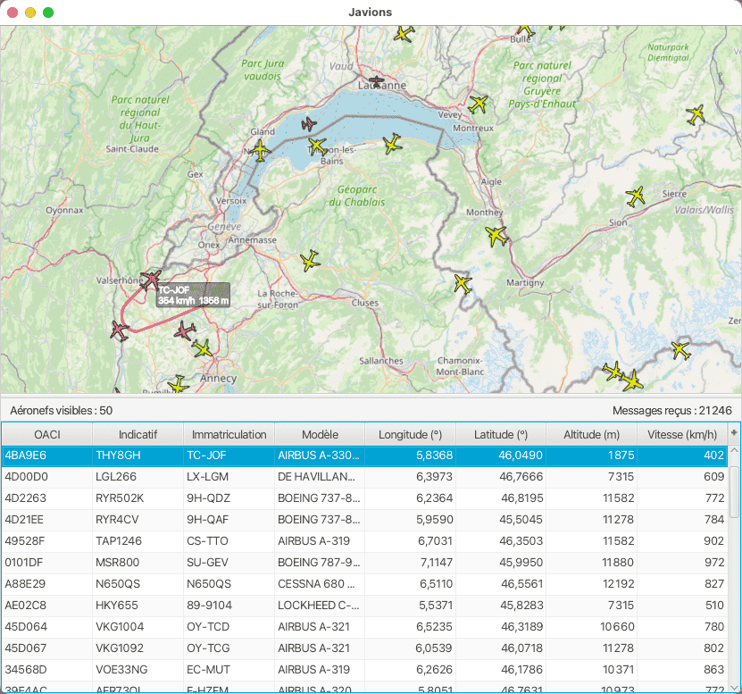

# Javions

Javions is a desktop ADS-B flight tracker built in JavaFX. It replays recorded aircraft position messages on top of OpenStreetMap tiles and keeps a live table of the aircraft currently visible in the capture.

The project focuses on replaying recorded ADS-B traffic through a desktop interface that combines a moving map, live aircraft state, and local tile caching. The repository is structured so it can be launched directly with a bundled sample capture.

## What it does

- Replays a bundled ADS-B message capture out of the box.
- Shows aircraft on a scrollable, zoomable map.
- Lists ICAO, callsign, registration, model, position, altitude, and speed in a sortable table.
- Caches OpenStreetMap tiles locally in `tile-cache/`.
- Still supports stdin-based demodulation for compatible raw sample streams.

## What it is not

- Not a polished consumer flight-tracking app.
- Not a full SDR ingestion pipeline: the repo does not include RTL-SDR capture scripts or hardware setup.
- Not a live network service: it is a desktop replay and visualization tool.

## Requirements

- Java 17
- A JavaFX SDK installed locally

The launcher expects `JAVAFX_LIB` to point to the JavaFX SDK `lib` directory.

Example:

```bash
export JAVAFX_LIB="$HOME/sdk/javafx-sdk-21.0.2/lib"
```

## Run it

Replay the bundled sample capture:

```bash
./scripts/run-app.sh
```

Replay a specific recorded message file:

```bash
./scripts/run-app.sh resources/messages_20230520_1725.bin
```

Use stdin mode instead of replay mode:

```bash
./scripts/run-app.sh --stdin
```

The first run creates `build/` for compiled classes and `tile-cache/` for map tiles.

## Screenshot

This is what the app looks like while replaying the bundled capture:



## Included data

- `resources/aircraft.zip`: aircraft metadata used to enrich ICAO addresses.
- `resources/messages_20230520_1725.bin`: bundled replay capture used for the default demo mode.

## Notes

- The app now defaults to the bundled replay instead of waiting silently on stdin.
- OpenStreetMap tiles are fetched on demand from `tile.openstreetmap.org` and cached locally.
- I could not run the JavaFX app in this workspace because no JavaFX SDK is installed here.
